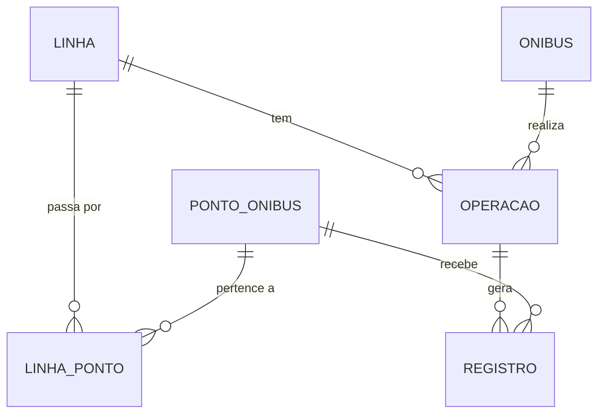

# API de pontos de onibus - Global solution

## Integrantes

Andre Sousa Matuda RM 566733 | Guilherme Barca Nascimento Silva RM 568517 |
Guilherme Oliveira Feitosa RM 566842 | Kaliel Conceição de Aquino RM 567587 | Paulo Henrique Muniz RM 567618

Link do Video:
n/a

Problema e solução

* Uma API que informa, para cada ponto, as linhas que o atendem e as últimas chegadas registradas.
* Cidadão beneficiado: usuários do transporte público em geral.
* ODS: 11 (Cidades e comunidades sustentáveis), 10 (Redução das desigualdades) e 9 (Indústria, inovação e infraestrutura).

Tecnologias

Java 21, Spring Boot 4.1, Spring Web, Spring Data JPA, Bean Validation, Spring Security com JWT, Spring Cache, Spring HATEOAS, Actuator, Swagger/OpenAPI (springdoc), Oracle e Maven.

## Como rodar

** JDK 21

### 1 Criar as tabelas no Oracle

Conecte no Oracle:
Host `oracle.fiap.com.br` · Porta `1521` · SID `ORCL` · usuário e senha do Oracle.

Na pasta `sql/`, abra e execute os dois scripts:
`bancoAPI.sql`
`complemento_java.sql`

### 2 Abrir o projeto

No IntelliJ, aguarde o Maven baixar as dependências.

### 3 Informar o usuário e a senha do Oracle

A senha não fica no código. Informe assim:

1. Abra a classe `CitizentechApiApplication` e clique no triângulo verde ao lado do `main`.
2. Vá em Run > Edit Configurations, escolha `CitizentechApiApplication` e clique em Modify options.
3. Marque Environment variables e preencha o campo que apareceu com:

DB_USER=seu_usuario;DB_PASSWORD=sua_senha

### 4 Rodar

Rode o programa

### 5. Testar

http://localhost:8080/swagger-ui/index.html

1. Em `POST /auth/login`, clique em **Try it out**, use `{"login":"admin","senha":"admin123"}` e clique em **Execute**.
2. Copie o valor de `token` da resposta.
3. Clique em **Authorize** (cadeado, canto superior direito), cole o token e confirme.
4. Teste qualquer endpoint, por exemplo `GET /api/pontos`.

**Pode rodar pelo terminal também (:** com `JAVA_HOME` apontando para o JDK 21, defina `DB_USER` e `DB_PASSWORD` como variáveis de ambiente e rode `./mvnw spring-boot:run` (no Windows: `.\mvnw.cmd spring-boot:run`).

## Usuários de teste

Papel 	Login	Senha	Permissão
------------------------------------------------------
ADMIN	admin	admin123	Consultar, cadastrar, alterar e excluir
---------------------------------------------------------------------
USER	usuario	usuario123	consultar 
------------------------------------------------------

## Diagrama das entidades

## Justificativa das consultas

| Tipo | Onde | Por quê |
| Derivada | `findByEnderecoContainingIgnoreCase`, `findByStatus` | Buscas simples |
| JPQL (`@Query`) | `buscarPorPonto`, `contarConflitos` | Consultas com junção e contagem |
| Specification | `OperacaoSpecs.comFiltros` | Filtros opcionais (data, linha, ônibus) |

## Justificativa do cache

Cacheamos a lista de pontos (pontos) e as linhas de cada ponto (linhasDoPonto): são as consultas mais frequentes do app e os dados mudam pouco. Toda escrita que afeta esses dados limpa o cache (@CacheEvict). O cache é em memória e zera ao reiniciar.